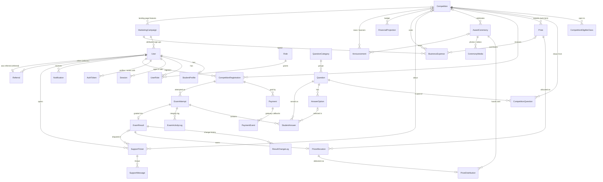

# Database design & ER diagram

Microsoft SQL Server, managed with Prisma migrations (`prisma/schema.prisma`, `prisma/migrations/`). 41 tables, 43 foreign keys.

## Design rules

| Rule | Why |
|---|---|
| `INT IDENTITY` primary keys; separate public codes (`registrationNumber`, payment `reference`, attempt `publicId`, `ticketNumber`) | Fast clustered keys; URLs never expose sequential IDs for sensitive flows |
| Status/type columns are `NVARCHAR` with allowed values in `src/lib/constants.ts`, validated with zod | SQL Server has no enum type |
| `ON DELETE NO ACTION` by default; `CASCADE` only for leaf children (sessions, options, answers, logs, media) | SQL Server forbids multiple cascade paths; records with history are archived, not deleted |
| Unique indexes only on `NOT NULL` columns | SQL Server treats NULLs as equal in unique indexes |
| Phone number is **not** unique | Families in rural areas often share one mobile number |
| Money is `DECIMAL(12,2)`; marks/scores are `FLOAT` (multiples of 0.25 are exact) | Exact currency arithmetic |
| Long text is `NVARCHAR(MAX)` | Prisma's default `NVARCHAR(1000)` is too short for rules/descriptions; Unicode for Urdu/Sindhi |
| Projections (`FinancialProjection`) are stored apart from actuals (`Payment`, `BusinessExpense`) | Estimates never mix with real figures |
| `ExamResult.meritRank` + `Competition.resultsStatus` form the leaderboard | One source of truth — no copied leaderboard table to drift out of sync |

## Entity–relationship diagram



Stand-alone tables: `SiteSetting`, `ContentPage`, `FaqItem`, `Testimonial`, `NewsletterSubscriber`, `NotificationBroadcast`, `EmailOutbox`, `AuditLog`.

## Key constraints

| Table | Constraint | Purpose |
|---|---|---|
| `CompetitionRegistration` | `UNIQUE (userId, competitionId)` | One registration per student per competition |
| `ExamAttempt` | `UNIQUE (registrationId, attemptNumber)` | Concurrent "start" clicks cannot create two attempts |
| `StudentAnswer` | `UNIQUE (attemptId, questionId)`, `UNIQUE (attemptId, position)` | Each question served once, in a fixed order |
| `ExamResult` | `UNIQUE (attemptId)` | One result per attempt (submission is idempotent) |
| `PrizeAllocation` | `UNIQUE (resultId)` | A result earns at most one prize |
| `PrizeDistribution` | `UNIQUE (allocationId)` | One delivery record per prize |
| `Payment.reference`, `Session.tokenHash`, `AuthToken.tokenHash`, `User.email`, `User.referralCode` | `UNIQUE` | Lookup keys |

## Module → tables

| Module | Tables |
|---|---|
| Authentication & roles | User, Role, UserRole, Session, AuthToken, StudentProfile |
| Competitions | Competition, CompetitionEligibleClass, Prize, CompetitionQuestion |
| Question bank | QuestionCategory, Question, AnswerOption |
| Registration & payments | CompetitionRegistration, Payment, PaymentEvent |
| Examination | ExamAttempt, StudentAnswer, ExamActivityLog |
| Results & leaderboard | ExamResult, ResultChangeLog |
| Prizes & ceremonies | PrizeAllocation, PrizeDistribution, AwardCeremony, CeremonyMedia |
| Communication & support | Notification, NotificationBroadcast, EmailOutbox, SupportTicket, SupportMessage |
| Marketing | MarketingCampaign, Referral, NewsletterSubscriber, Announcement |
| Finance | BusinessExpense, FinancialProjection |
| Content & audit | SiteSetting, ContentPage, FaqItem, Testimonial, AuditLog |

## Backups (SQL Server Express)

SQL Server Express has no SQL Agent jobs, so schedule a nightly backup with Windows Task Scheduler:

```powershell
sqlcmd -S .\SQLEXPRESS -E -Q "BACKUP DATABASE RewardingPotential TO DISK='D:\Backups\RewardingPotential.bak' WITH INIT, CHECKSUM"
```

(On Standard/Enterprise editions add `COMPRESSION`.) Keep at least 14 daily copies, store one copy off the machine, and test a restore monthly. Back up `storage/uploads/` alongside the database.
